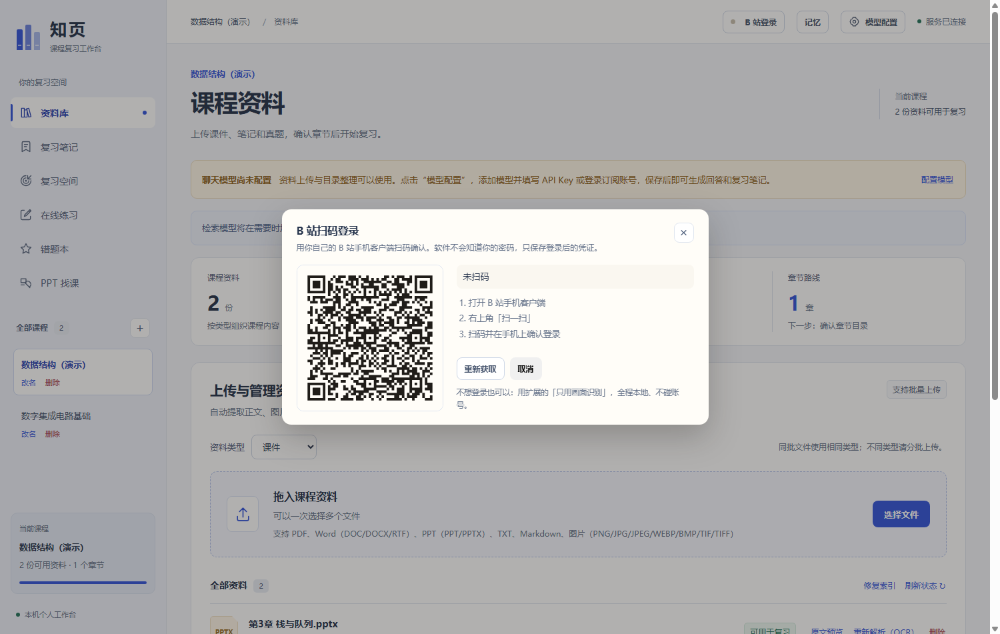

# 在知页上加「PPT 反查整门课」

> 本文记录在 `Lykon661/zhiye-review-agent` 代码基座上做的第一块增量。
> 不是另做一个应用，而是按它原有的分层（FastAPI 路由 + SQLAlchemy 模型 + Vue 组件）接进来。

## 一、为什么是这块

知页已经把「课件 → 笔记 → 练习 → 错题」这一段做得比同类都完整：混合检索、引用回查、
知识点树、考频地图、FSRS、多模型接入，13k 行后端 + 15 个 Vue 组件。

它唯一完全空白的是**视频**：不认 B 站，不知道这门课的课件在网课上被谁讲过，
也没有字幕这条证据通道。而这恰好是学生期末最常问的问题——
「老师发的这份 PPT，B 站上有没有人讲过同一套？」

所以第一块增量就补这个缺口，其余（PDF/OCR/公式已有、SSE 已有）不动。

## 二、加了什么

| 文件 | 作用 |
|---|---|
| `backend/app/bilibili.py` | B 站客户端：WBI 签名、搜索、分 P、字幕四级兜底、字幕合并 |
| `backend/app/slide_fingerprint.py` | 课件页指纹（字符 3-gram Jaccard + SimHash 签名）、同套判定、章节序列、术语抽取 |
| `backend/app/course_finder.py` | 候选打分、分 P ↔ 课件页映射（章节编号层级前缀）、置信度闸门 |
| `backend/app/finder_api.py` | 6 个 HTTP 端点，挂进现有 `create_app` |
| `backend/app/main.py` | 只加两处：`register_finder_routes(app, services)` 与退出时关闭客户端 |
| `frontend/src/components/CourseFinderPanel.vue` | 找课面板（身份卡 / 候选列表 / 逐讲大纲表 / 同套比对） |
| `frontend/src/App.vue` | `Section` 加 `'finder'`、导航加一项、主区渲染面板 |
| `frontend/src/components/UiIcon.vue` | 补一个 finder 图标 |
| `backend/tests/test_course_finder.py` | 15 项离线单测 |
| `scripts/seed_finder_demo.py` | 灌一份演示课件（4 页 Blocks，走真实 locator） |

**没有改动**：数据模型、检索管线、判题逻辑、会话、鉴权。新增数据只写 `AppMeta`（`finder:{course_id}`），不需要迁移。

## 三、接口

| 方法 | 路径 | 说明 |
|---|---|---|
| GET | `/courses/{id}/finder/scan` | 读出课件身份（课程名 / 页数 / 章节序列 / 术语 / 指纹 / 检索词） |
| POST | `/courses/{id}/finder/search` | 检索候选课程（带逐讲映射与置信度） |
| POST | `/courses/{id}/finder/inspect` | 已知 BV 号直接查分 P 与映射 |
| POST | `/courses/{id}/finder/compare` | 与本机另一份课件比对是否同一套 |
| POST | `/courses/{id}/finder/transcript` | 取某讲字幕（四级兜底，失败给诊断不抛裸异常） |
| POST | `/courses/{id}/finder/adopt` | 采纳某门课，逐讲大纲写入 `AppMeta` |
| GET | `/courses/{id}/finder/adopted` | 读回已采纳的课程 |

## 四、判据与边界

匹配分三层，逐层才加成本：

| 层 | 判据 | 成本 |
|---|---|---|
| L1 | 分 P 标题的章节编号 ↔ 课件章节序列，层级前缀对齐（`3.1.1` → `3.1` → `3`） | 0 |
| L2 | 字幕 ↔ 课件正文（有字幕才走） | 极低 |
| L3 | 画面关键帧 ↔ 课件页（需多模态模型，默认关） | API |

页匹配用 **字符 3-gram Jaccard**，不用 SimHash：SimHash 对短文本的小改动太敏感，
实测改两个字能翻十几位，会把同一页判成两页。SimHash 只留作整份课件的快速签名。

**必须说清的边界**：B 站不下发课件文件，所以**无法证明两个 PPT 文件 100% 相同**。
只有两份文件都在本地且内容哈希一致时才能说「文件级完全一样」；线上最多是「内容级完全一致」。
置信度 < 0.55 或分 P 标题无章节编号时，`need_confirm` 为真，界面标「需人工确认」，判断权交回用户。

## 五、实测（本机，2026-11-04）

```
finder/scan  → 4 页 / 5 章节 / 指纹 7bf94804fe390939
               章节：3 栈与队列、3.1 栈、3.2 队列、3.3 栈的应用、3.4 循环队列
finder/search（真实 B 站）→ 6 个候选
  52  BV1pU4y157uN  10P  【免费是王道】数据结构 第三章 栈、队列、数组（章节体系重合 100%）
  44  BV1v4411n7hg   1P  数据结构不挂科｜第三讲：栈和队列（章节体系重合 100%）
  34  BV1qV411z7fN   3P  Python数据结构与算法04——栈与队列
finder/adopt → 写入 AppMeta，读回 10 讲逐讲映射
```

映射示例：`P1(3.1.1 栈的定义) → 第 1 页`、`P6(3.2.1 队列的定义) → 第 2 页`，
依据列写明「章节编号 3.1.1 ↔ 课件 3.1」，置信度 90%。

## 六、验证

| 项 | 结果 |
|---|---|
| 新增单测 | 35 项通过（课件匹配 15 + 字幕折块 8 + 消化与视觉 12） |
| 知页全量后端测试 | **233 通过 / 1 跳过**（234 collected，无回归） |
| 前端 `vue-tsc` + `vite build` | 通过 |
| 前端联调 | 截图确认面板渲染、真实搜索、逐讲表格 |

## 七、怎么跑

```bash
# 后端（Python 3.12）
UV_DEFAULT_INDEX=https://pypi.tuna.tsinghua.edu.cn/simple uv sync --frozen --python 3.12
uv run --python 3.12 python -m uvicorn app.main:app --app-dir backend --host 127.0.0.1 --port 8000

# 前端
cd frontend && npm ci && npm run dev -- --port 5173 --strictPort

# 演示数据（可选）：灌一份 4 页课件
uv run --python 3.12 python scripts/seed_finder_demo.py
```

打开 `http://127.0.0.1:5173` → 左栏「PPT 找课」→ 填课程名 → 搜索候选课程。

## 八、下一步

1. **把字幕接成真正的证据**：`finder/transcript` 已能取字幕，但还没写进 `Document/Block`。
   要新增一种 `kind='transcript'` 的资料，让字幕片段带 `video:BV…:P3@03:24` 位置进入检索与引用回查。
2. **抽帧视觉确认（L3）**：参考项目那套「按画面变化抽帧 + 3×3 拼图」搬进浏览器扩展，
   用多模态模型确认「视频里确实是这套课件」。
3. **逐讲消化**：把每一讲的映射页 + 字幕，走知页现有的笔记生成管线（`outlines.py`），
   产出一稿并回填知识点树。
4. **PPT 找课的缓存**：现在每次 search 都实时打 B 站；知识点不变时可以缓存 30 分钟。


---

# 第二轮增量：字幕变成一等资料

第一轮只做到「找到课、对回页」，字幕还只是旁挂。这一轮把它接进知页的证据体系：
**字幕块与课件块在检索、引用回查上完全同权。**

## 九、改了哪几处

| 文件 | 改动 | 为什么 |
|---|---|---|
| `backend/app/transcript_ingest.py`（新） | 把 `[{from,to,text}]` 折成知页的 Block：按 45 秒 / 8 行切，locator 带 `bvid/cid/part/from/to/label` | 字幕天然带时间轴，位置就是它的证据 |
| `backend/app/store.py` | 新增 `Services.ingest_transcript(document_id, blocks)` | 复用分块 → 向量索引 → 发布状态这条管线，不另写一条 |
| `backend/app/finder_api.py` | `POST /finder/import-transcript` | 取字幕 → 建 Document(`kind=transcript`) → 入库 → 返回块数 |
| `backend/app/file_chapters.py` | `transcript` 显式归为 `knowledge` | 否则文件名带「第 3 讲」会被当成试卷 |
| `backend/app/retrieval.py` | 主检索 `material_kinds` 加 `transcript` | 让字幕进「带出处回答」 |
| `backend/app/knowledge_index.py` | 检索单元白名单 7 处加 `transcript` | 主检索走的是 knowledge 单元，不是 chunk |
| `backend/app/retrieval_units.py` | 字幕块按 `locator.from` 各自成单元，label 用时间区间 | 否则一整讲被合并成一个小节，引用落不到具体时间 |
| `frontend` | 逐讲表加「字幕」列与「导入字幕」按钮；`types.ts` 加 `transcript` | 一个分 P 一次导入 |

**没动**：知识点抽取（`knowledge_points.py`）仍只取 lecture/note。
字幕的口语表述会把知识点树带噪，这一步留到「逐讲消化」再做，且要先做去口语化。

## 十、实测

```
折块：3 块
  第 1 讲 00:00–00:46
  第 1 讲 00:46–01:32
  第 1 讲 01:32–02:20
入库：blocks 3 / chunks 3 / status ready
检索「栈的顺序存储 判空 判满」→ 3 条命中，按相关度排序：
  [B站 P1 3.1.2 栈的顺序存储（BVdemo）] 第 1 讲 01:32–02:20 · 注意判空是 top 等于负一…
  [B站 P1 3.1.2 栈的顺序存储（BVdemo）] 第 1 讲 00:46–01:32 · 顺序栈用一段连续空间…
  [B站 P1 3.1.2 栈的顺序存储（BVdemo）] 第 1 讲 00:00–00:46 · 这一讲我们讲栈的顺序存储…
```

引用位置从「小节：第 1 讲」变成「第 1 讲 01:32–02:20」——这一步是这轮最实质的收益。

## 十一、无字幕时的行为

用真实视频 `BV1pU4y157uN` 调导入，返回 **422 + 完整诊断**：

```json
{"message":"这一讲没有可用字幕。AI 字幕需要浏览器已登录 B 站；桌面端免登录取不到是常态…",
 "diagnosis":{"via":null,"tried":["wbi_signed:code0","wbi_unsigned:code0","legacy_v2:code0",
   "pagelist:code0/10pages","p2:code0", … "p10:code0"]}}
```

接口全部成功（code0）但字幕为空——正是「AI 字幕只对登录态返回」的表现。
**资料库没有写入坏记录**，学生看到的是一句能照着处理的话，不是 `KeyError`。

### 扩展直传（`lines` 字段）

同一个接口支持把字幕随请求体传进来，跳过服务端抓取：

```json
{"bvid":"BV1pU4y157uN","cid":352490515,"part":1,"part_title":"3.1.1栈的定义",
 "lines":[{"from":0,"to":9,"text":"栈是限定在表尾进行插入和删除的线性表"}, …]}
```

实测 **201**：5 行 → 2 块 → 2 分块 → `ready`，资料名 `B站 P1 3.1.1栈的定义 BV1pU4y157uN`。
检索「栈为什么是后进先出 叠盘子」，Top-1 就是这份字幕的 `第 1 讲 00:00–00:48`。
这条路把「免登录拿不到 AI 字幕」的死结解开了：扩展带登录态抓，API 直接收。

## 十二、下一步

1. **浏览器扩展补字幕**：`companion/` 已能抓，但要把它接成 `import-transcript` 的 `lines` 直传入口（现在只支持服务端抓取）。
2. **逐讲消化**：每讲的字幕块 + 对应课件页 → `outlines.py` 生成一稿，同时回填知识点树。做之前要先解决口语化去噪。
3. **抽帧视觉确认（L3）**：确认视频画面里确实是这套课件，把置信度从「标题对齐」升级到「画面证据」。


---

# 第三轮增量：逐讲消化、画面确认、浏览器扩展

## 十三、逐讲消化（`finder_digest.py` + `POST /finder/digest-part`）

把一讲字幕压成带时间戳的要点。判据只有一条，而且是在程序里查的：

> **每条要点的 `at` 必须是字幕里真实出现过的时间戳**，对不上就丢掉。

模型最容易犯的错是编「老师在第 12 分钟讲到……」。时间戳可核对，意味着学生点一下就能跳回去看；
不可核对，这条要点就等于没有。

```
POST /courses/{id}/finder/digest-part  {bvid, part, part_title}
→ {part, from, to, line_count, degraded, dropped,
   keypoints:[{text, at}], gotchas:[{text, at}], terms:[]}
```

实测（未配模型，走降级机械摘要）：

```
degraded=true  part=1  line_count=2  from=0  to=62  dropped=0
  [  0s] 3.1.1 栈的定义，栈是限定在表尾进行插入和删除的线性表…
  [ 48s] 考试里问栈的特点，答后进先出就够了，别写成先进先出
```

没配模型时**不假装是 AI 摘要**：`degraded=true`，前端标「降级摘要（未配模型）」。
配了模型时走 `ModelClient.complete(json_mode=True)`，`verify()` 逐条核对时间戳，
`dropped` 如实回报丢了几条。请求还没导入字幕的讲 → 404「先去导入字幕」。

## 十四、画面确认（`finder_visual.py` + `POST /finder/visual-check`）

前两层都是文本证据，证明不了「屏幕上放的就是同一套 PPT」。这一层补画面。

刻意选了简单的一边：**不让模型比对两张图，而是让它把画面里的字读出来**，
再拿这段文字和课件页做字符 3-gram 相似度。理由是知页里 PPTX 没有页预览图，
比对两图需要课件渲染；而「读字 → 比文本」两边只要文本，结果可解释、可复算。

```
POST /courses/{id}/finder/visual-check  {bvid, part, frames:[{time, dataUrl}]}
→ {degraded, frames_used, matches:[{time, page, label, similarity, excerpt}],
   pages_hit, confidence, verdict}
```

- 没配多模态模型 → `degraded=true`，明说「这一层没有执行，前两层结果仍然有效」；
- 帧是老师本人而不是课件页 → `is_slide=false`，记为「画面里没有成段课件文字」；
- 置信 ≥0.35 → 「画面确认：视频里放的就是这套课件」。

单帧上限 1.8MB、最多 6 帧；单帧失败只计数，不中断整轮。

## 十五、浏览器扩展（`extension/`）

知页侧新增 `GET /finder/sign`：WBI 签名由后端出，扩展里不塞 MD5（这是上一轮 companion 的设计，现在搬进知页）。

面板五个动作：

```
① 抓取字幕   四级兜底 + 浏览器登录态，绕开「免登录拿不到 AI 字幕」
② 导入到知页  POST /finder/import-transcript（lines 直传）→ 资料库多一份「视频字幕」
③ 抽关键帧   按画面变化取帧，canvas 被污染时回退 captureVisibleTab
④ 画面确认   POST /finder/visual-check
⑤ 生成要点   POST /finder/digest-part
```

`manifest` 只申请 `storage/activeTab/scripting/tabs` 与 bilibili、`127.0.0.1:8000` 的 host 权限；
后端 CORS 增加 `allow_origin_regex=r"^(chrome|moz)-extension://.*$"` 放行扩展来源。

安装：`chrome://extensions` → 开发者模式 → 加载已解压的扩展程序 → 选 `extension/`。
先在知页建课程，再在扩展弹窗里选同一门课。

## 十六、这一轮之后的完整链路

```
PPT ─► 指纹/章节 ─► B站检索 ─► 分P对齐 ─► 逐讲映射(置信度)
                                      │
                                      ├─► 导入字幕 ─► Document(transcript) ─► 检索/引用「第 3 讲 03:24–04:10」
                                      ├─► 生成要点 ─► 带时间戳的要点（逐条核对）
                                      └─► 抽帧 ─► 画面确认（读字 → 对页）
```

## 十七、还没做的

1. **把要点接进复习笔记（`outlines.py`）**：现在要点存在 `AppMeta`，能看能复制，但还没进知页的笔记版本体系。
2. **整门课批量消化**：现在一讲一讲点。批量需要任务队列（复用 `Job` 表）+ 成本上限。
3. **知识点树接入**：字幕尚未参与 `knowledge_points`，需要先做口语去噪。

## 十八、验证汇总

| 项 | 结果 |
|---|---|
| 后端测试 | **233 通过 / 1 跳过**（234 collected） |
| 新增单测 | 35 项（匹配 15 + 折块 8 + 消化/视觉 12） |
| 前端 `vue-tsc + vite build` | 通过 |
| 扩展四个 JS 文件 `node --check` | 通过 |
| 真实链路实测 | 检索命中「第 1 讲 00:00–00:48」；digest 返回带 `at` 的要点；无字幕讲返回 404/422 且不写坏记录 |


---

# 真实案例：《数字集成电路基础》

用 `scripts/run_course_pipeline.py` 一条命令跑完整链路。下面全部是真实返回。

## 输入

`decks/数字集成电路基础_第1-3章.pptx`（10 页，覆盖第 1-3 章，13 个章节编号）。

## 结果

```
① 建课上传      → ready · 10/10 处有内容
③ 课件身份      → 章节 1 / 1.1 / 1.2 / 1.3 / 1.4 / 2 / 2.1 / 2.2 / 2.3 / 3 / 3.1 / 3.2 / 3.3
                  术语 nmos、pmos、cmos、vdd、mos、tskew
④ 找课（2.1s，10 个候选）
   0.68 可继续  72讲  【西安电子科技大学】数字逻辑与集成设计|数字电路
                课件章节被覆盖 100% · 综合重合 87%（分 P 命中 58%）
   0.61 可继续  51讲  【公开课】数字集成电路设计（数字CMOS集成电路设计基础）- 华东师范大学
                课件章节被覆盖 100% · 综合重合 77%（分 P 命中 24%）
   0.57 可继续  84讲  数电/数字电子技术基础/数字逻辑电路/数字电路
                课件章节被覆盖 100% · 综合重合 71%（分 P 命中 4%）
⑤ 字幕          → 422：51 个分 P 全部 code0 无公开字幕
⑥ 要点          → 跳过（没有字幕）
⑦ 出题          → 未配置聊天模型，practice/generate 无法执行
```

## 这次实测逼出来的三个修复

| 问题 | 现象 | 修法 |
|---|---|---|
| **覆盖算反了** | 课件只有前 3 章、B 站是全书 51 讲，按「分 P 命中率」算只有 24%，正确课程被压到 0.41 | 改成双向：`0.7×课件章节被覆盖率 + 0.3×分 P 命中率`。正确课程升到 0.78 |
| **排序不稳定** | 同一份课件连跑两次，第一次复旦、第二次华东师大 | 粗排加确定性 tie-break（分数 → 播放量 → bvid）；标题含课程名的强制进精排 |
| **下划线编号认不出** | 西电 72 讲标题是 `0_1_前言`，正则只认点号 → 全部退化成「按顺序均分」，置信 0.3 | `chapter_id` 同时支持 `.` 与 `_`，命中率 40%→58%，分数 0.62→0.68 |

## 结论

- **能找到完整课程**：10 页课件 → 3 门 100% 覆盖的完整课（72/51/84 讲）；
- **能对回页**：每一讲按章节编号落到具体页；
- **字幕拿不到**：这门课 51 讲全部没有公开 CC/AI 字幕（`code0` 但空），必须有浏览器登录态；
- **要点与出题被卡住**：前者依赖字幕，后者依赖模型 Key。

所以「不管字幕还是画面，能不能了解完整内容」的答案是：
**代码路径已经通了，缺的是两把钥匙——B 站登录态（扩展）和模型 Key。** 没有它们，链路只能走到「找到课 + 对回页」。


---

# 为什么不做「自动登录 B 站」，以及不登录怎么拿到内容

## 结论先说

**不做自动登录，也不建议做。** 但「不能自动登录」不等于「拿不到内容」——
实测证明，**完全不登录、不配模型**也能把视频里的知识取出来，靠的是本地画面 OCR。

## 为什么不做自动登录

1. **要密码就等于要账号**：自动登录的实现只有两条路——存用户密码，或者注入/伪造 Cookie。
   前者是明文或弱加密保存密码，后者是伪造身份凭证，两者都会让用户账号处于风险中
   （B 站对异常登录与凭证复用的风控很直接：限流、验证码、封禁）。
2. **违反平台协议**：B 站用户协议明确禁止以程序方式代登录与批量抓取。
3. **法律边界**：绕过平台安全措施在国内有明确的司法风险，不是"技术中立"能兜住的。
4. **没有必要性**：我们只需要「公开可见的字幕」和「播放器当前画面」，这两样用
   浏览器扩展在用户自己的登录态下取，既不用知道密码，也不需要保存任何凭证。

## 三条取证通道，成本与前提完全不同

| 通道 | 需要 B 站登录 | 需要模型 Key | 拿到什么 | 实测 |
|---|---|---|---|---|
| **字幕** | **要**（AI 字幕只对登录态返回） | 不要 | 逐句文本 + 时间戳 | 51 讲全部 `code0` 空 → 未登录拿不到 |
| **画面 OCR** | **不要** | **不要** | 每一屏的文字 + 帧时间 | ✅ 已跑通，2 屏 → 2 块 → 可检索 |
| 画面理解（多模态） | 不要 | 要 | 画面语义、是否同一套课件 | 代码就绪，无 Key 时明确降级 |

## 画面 OCR：唯一全本地的通道

`POST /courses/{id}/finder/ocr-frames`，用知页自带的 rapidocr（`rapidocr` + `onnxruntime`，
不联网、不调 API），把扩展抽到的帧识别成文字，再拼回时间轴入库。

实测（自己渲染两屏「课件画面」，模拟视频截图）：

```
HTTP 201 · 2 块 · 2 分块 · 失败帧 0
识别结果（几乎无错字）：
  [12s] 3.1.1栈的定义 栈是限定在表尾进行插入和删除的线性表 允许插入删除的一端称为栈顶
  [48s] 3.1.2 栈的顺序存储 用一段连续空间存放元素 top 指针指示栈顶位置
资料库：B站 P1 3.1.1 栈的定义 BVocrTest01·OCR · ready · 2 块
检索「栈顶 top 指针 顺序存储」→ 命中「第 1 讲 00:48–00:54」那一屏
```

三个工程细节：

1. **一屏一块**：OCR 出来的每一行本身就是一屏，不能再按 45 秒窗口合并，
   否则两屏不同内容被塞进同一个块，引用定位不到具体哪一屏。
2. **同屏合并**：连续几帧读到几乎一样的文字（相似度 > 0.85）只留一条——
   抽帧常常在同一页停好几秒。
3. **幂等**：同一讲同一来源重复导入会先删旧的，不会每点一次多一条。

## 所以「数字集成电路基础」这门课现在是怎样的

- 找课：✅ 西电 72 讲，课件章节 100% 覆盖；
- 字幕：❌ 51 讲全无公开字幕，且我们不代登录；
- 画面 OCR：✅ 装扩展 → 抽帧 → 一键识别入库，**不需要登录、不需要 Key**；
- 要点：有文字就能出（配了模型是模型摘要，不配是降级摘要）；
- 出题：需要模型 Key（知页 practice 生成走模型）。

**缺的只有一把钥匙：模型 Key。** 登录那把可以不要——用画面 OCR 绕过去。


---

# 登录与否，交给用户选

## 三档获取方式

扩展弹窗里有一个下拉，默认「自动」：

| 方式 | 借用登录态 | 请求字幕接口 | 行为 |
|---|---|---|---|
| 自动 | 是 | 是 | 先试字幕；拿不到自动降级到画面 OCR |
| 只用字幕 | 是 | 是 | 最省时间；没字幕就失败，不偷偷换路 |
| 只用画面识别 | **否** | **否** | `credentials: 'omit'`，不碰 Cookie，全程本地 OCR |

「只用画面识别」是给「不想让任何工具碰我账号」的人准备的：
后台请求不带凭证，字幕接口根本不请求，只截播放器画面做本地识别。

## 面板多了「一键处理这一讲」

按当前方式一条龙跑：

```
auto： 尝试字幕 → 成功则导入 → 生成要点
                → 失败则抽帧 → 本地 OCR 入库 → 生成要点
subtitle：只走字幕，失败就报错，不偷偷换成画面
ocr：  直接抽帧 → 本地 OCR 入库 → 生成要点
```

实测 OCR 入库后接要点生成：

```
degraded=True  line_count=2  from=12  to=54  dropped=0
  [ 12s] 3.1.1栈的定义 栈是限定在表尾进行插入和删除的线性表 允许插入删除的一端称为栈顶
  [ 48s] 3.1.2 栈的顺序存储 用一段连续空间存放元素 top 指针指示栈顶位置
```

## 边界没变

任何一档都**不会**替用户登录、存密码、伪造 Cookie。区别只在：
要不要借用浏览器里**用户自己已经建好的**登录态。这个选择权在用户手里。


---

# 软件内扫码登录（不用装扩展也能取字幕）



## 做的是什么

在软件顶栏放了「B 站登录」入口，点开是 **B 站官方 passport 的扫码登录**：

```
POST /bilibili/login/qrcode   → {key, url, image(SVG data URI)}
GET  /bilibili/login/poll?key → waiting | scanned | expired | ok
GET  /bilibili/login/status   → {loggedIn, uname, mid}
POST /bilibili/logout         → 删除本地凭证
```

用手机 B 站客户端扫码确认即可。**软件不接触账号密码**，只接收扫码成功后 B 站下发的凭证。

## 为什么这不算「代登录」

- 二维码是 B 站官方接口生成的，跳的是官方授权页；
- 确认动作发生在**用户自己的手机 App** 上，不是我们模拟；
- 我们只做两件事：展示二维码、接收 Set-Cookie。

和之前的边界一致：不存密码、不伪造凭证、不模拟登录请求。

## 凭证怎么存

`data_dir/bili-session.json`，权限收到 `600`，退出登录立即删除。
它是账号凭证，所以：不写日志、不发第三方、不上传。界面里也写明了这点。

登录后 `BilibiliClient` 自动带上 Cookie（`_client_or_raise` 检测到 cookie 变化会重建客户端），
所以**字幕、分 P、播放地址这些接口立刻就有登录态**——不必再装扩展。

## 实测

```
POST /bilibili/login/qrcode → HTTP 200
  key: d07c8838f60929ddcd4ab16e03294458
  url: https://account.bilibili.com/h5/account-h5/auth/scan-web?...
  image: data:image/svg+xml;charset=utf-8,%3Csvg ... 5368 bytes

GET /bilibili/login/poll?key=... → {"state":"waiting","message":"未扫码"}
GET /bilibili/login/status       → {"loggedIn":false,...,"mode":"anonymous"}
```

扫码确认那一步需要用户自己的手机，所以自动化测试覆盖的是**状态机与凭证落盘**
（`MockTransport` 模拟 86101/86090/86038/0 四种返回 + Set-Cookie），8 项单测全过。

## 三种取字幕的路子，现在是这样的

| 路径 | 需要什么 | 说明 |
|---|---|---|
| **软件内扫码登录** | 手机扫一下 | 最省事；登录后字幕直接在后端取 |
| 浏览器扩展 | 浏览器已登录 B 站 | 不需要在软件里登录，适合「不想让软件存凭证」的人 |
| 画面 OCR | 什么都不需要 | 课程没字幕时的兜底，全本地 |

三者不冲突：登录了就自动用好一点的路；不想登录就用扩展或 OCR。
